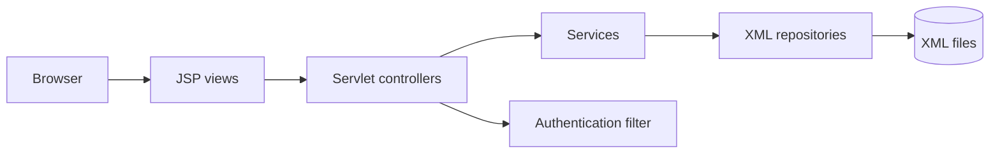
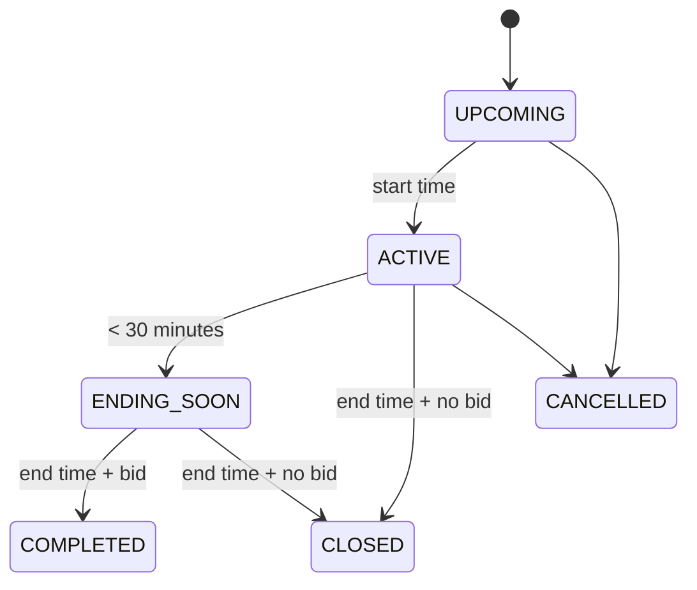

# BidX diagrams



```mermaid
sequenceDiagram
participant B as Bidder
participant S as PlaceBidServlet
participant V as BidService
participant X as XML repositories
B->>S: POST amount + auction id
S->>V: place()
V->>X: read auction; validate status/owner/minimum
V->>X: append bid and update highest bid
V-->>S: success or friendly validation error
S-->>B: redirect to auction details
```


